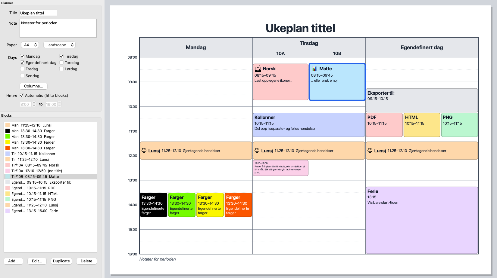
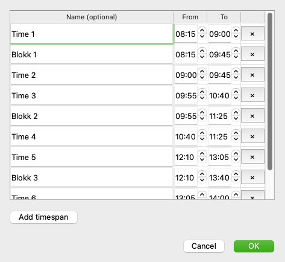

# Ukeplan

Program for å lage utskriftvennlige timeplaner

**[Last ned siste versjon](https://github.com/ensva002/ukeplan/releases/latest)**

## Funksjoner

- Blokker med tittel, beskrivelse, fra/til-tid, ikon og valgfri bakgrunnsfarge
- Kolonner innad i en dag, for eksempel én per gruppe eller klasse
- Emoji eller egne bilder som ikoner
- Lagre tidsrom for enkel gjenbruk (Time 2, Lunsj, Blokk 1, etc)
- Lagre og åpne `.timetable`-filer
- Eksport til PDF, PNG, SVG og HTML

## Installasjon

| Maskin | Fil |
|---|---|
| Windows | `Ukeplan-Windows.zip` |
| Mac (Apple-Silicon) | `Ukeplan-Mac-AppleSilicon.zip` |
| Mac (Intel) | `Ukeplan-Mac-Intel.zip` |
| Linux | `Ukeplan-Linux.tar.gz` |

- **Windows:** pakk ut mappen (høyreklikk ▸ Pakk ut alle) og åpne `Ukeplan.exe`. Kommer «Windows beskyttet PC-en din», klikker du **Mer informasjon** og deretter **Kjør likevel**.
- **Mac:** pakk ut, og dra **Ukeplan** til Programmer. Første gang: høyreklikk ▸ **Åpne** ▸ **Åpne**. Blir det blokkert, gå til Systeminnstillinger ▸ Personvern og sikkerhet, bla ned og klikk **Åpne likevel**.
- **Linux:** pakk ut og kjør `Ukeplan/Ukeplan`.

## Disclaimer
Dette er kun et verktøy jeg hadde behov for som jeg fikk KI til å slenge sammen for meg.
